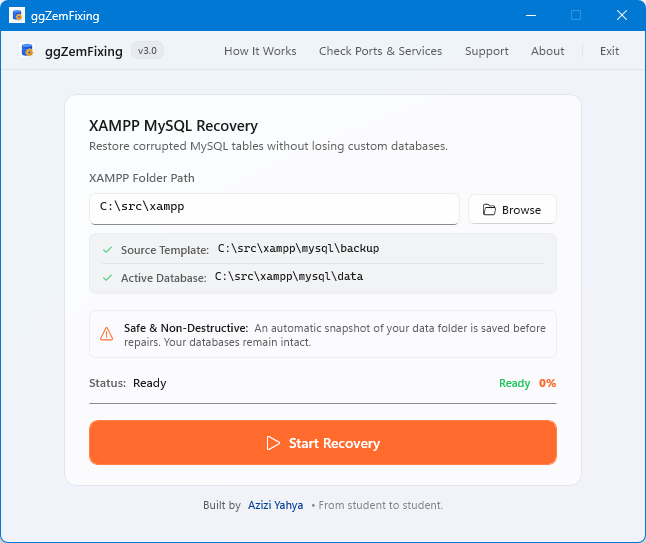
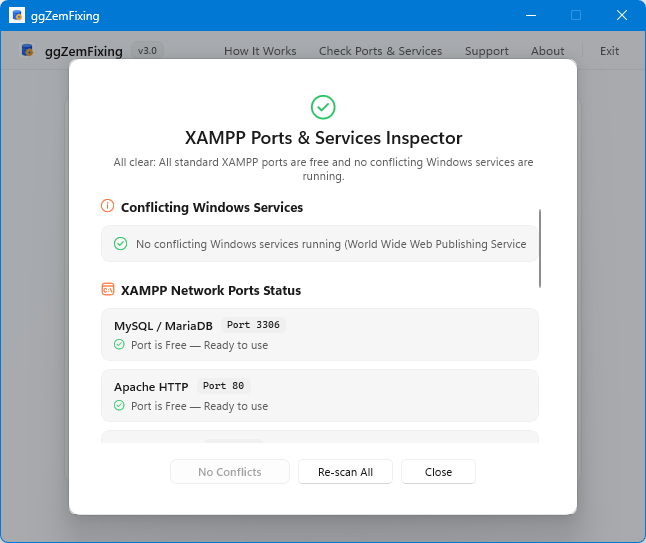

# ggZemFixing

<p align="center">
  
</p>

<h3 align="center">Automated XAMPP MySQL Database Recovery &amp; Port Conflict Resolver</h3>

<p align="center">
  A modern, safe, 1-click recovery utility for corrupted XAMPP MySQL databases and conflicting Windows services.
</p>

<p align="center">
  <a href="https://github.com/aziziyahya/ggZemFixing/releases/latest">
    
  </a>
  <a href="https://github.com/aziziyahya/ggZemFixing/releases/latest/download/ggZemFixing.exe">
    
  </a>
</p>

<p align="center">
  <a href="LICENSE"></a>
  
  
  
</p>

---

## 📸 Screenshots

<p align="center">
  
  
</p>
<p align="center">
  <em>Left: Main Recovery Interface with automatic XAMPP detection &bull; Right: Port &amp; Conflicting Windows Services Inspector</em>
</p>

---

## 📥 Download

Get the standalone portable executable directly from GitHub Releases — **no installation or external runtime required**:

| Download | Architecture | Type | Description |
| :--- | :---: | :---: | :--- |
| [**Download ggZemFixing.exe**](https://github.com/aziziyahya/ggZemFixing/releases/latest/download/ggZemFixing.exe) | `x64` | Portable Standalone | Single-file executable, ready to run. |
| [**View All Releases & Assets**](https://github.com/aziziyahya/ggZemFixing/releases/latest) | `x64` / Source | Release Notes | Changelogs, checksums, and source code. |

> [!NOTE]
> **ggZemFixing** is compiled as a self-contained, single-file binary. You do not need to install .NET 9 or the Windows App SDK runtime separately.

---

## ⚡ The Problem

When working with XAMPP on Windows, sudden power cuts, system crashes, or abnormal shutdowns frequently leave MySQL and Apache in an unbootable state:

```
[mysql]  Error: MySQL shutdown unexpectedly.
[mysql]  This may be due to a blocked port, missing dependencies,
[mysql]  improper privileges, a crash, or a shutdown by another tool.
[mysql]  InnoDB: Attempted to open a previously opened tablespace.
[Apache] Port 80 in use by "Unable to open process" with PID 4!
```

Manual recovery is tricky and risky:
- Overwriting the wrong files corrupts the InnoDB dictionary (`ibdata1`).
- Deleting corrupted transaction logs manually often results in permanent database loss.
- Background Windows services (such as IIS / `W3SVC` or rogue MySQL instances) silently hijack ports 80, 443, and 3306.

**ggZemFixing automates the entire repair pipeline safely in less than 3 seconds.**

---

## ✨ Features

### 🛡️ Non-Destructive Automated Recovery
- **Automatic Timestamped Backup**: Creates a complete snapshot of `mysql/data/` (`mysql/data_backup_yyyyMMdd_HHmmss/`) before touching any file.
- **System Table Reconstruction**: Safely resets core schemas (`mysql`, `performance_schema`, `phpmyadmin`) from the official XAMPP `mysql/backup/` template.
- **Custom Schema Preservation**: Automatically scans and transfers all user-created databases and `.ibd` tablespaces without data loss.
- **InnoDB Engine Protection**: Preserves `ibdata1` and resets corrupted redo logs (`ib_logfile0`, `ib_logfile1`).

### 🔍 Services & Port Diagnostics
- **Windows Service Inspector**:
  - Detects **World Wide Web Publishing Service (`W3SVC`)** (IIS blocking port 80).
  - Detects **Web Deployment Agent Service (`MsDepSvc`)**, **BranchCache (`PeerDistSvc`)**, and **SQL Server Reporting Services**.
  - Identifies standalone external MySQL or MariaDB services occupying port 3306.
- **1-Click "Fix & Continue"**:
  - Automatically stops blocking Windows services with elevation support.
  - Terminates rogue port-occupying processes and re-scans immediately.
- **Custom Port Detection**:
  - Reads custom ports defined in your `my.ini` and `httpd.conf`.
  - Scans MySQL (3306), Apache HTTP (80), Apache HTTPS (443), Tomcat (8080), and FileZilla (21).

### 🎨 Modern Fluent Interface
- Built with **WinUI 3 (Windows App SDK)** and modern Windows 11 Fluent design principles.
- Real-time directory validation chips: **XAMPP Detected**, **Source Template Verified**, **Active Database Verified**.
- Automatic installation detection for common paths (`C:\xampp`, `C:\src\xampp`, `D:\xampp`, `E:\xampp`).
- **In-App Update Checker**: Directly queries GitHub for the latest release and presents new version info inside an in-app modal dialog.
- **Multi-Option Support Page**: Supports DuitNow QR and 1-click Bitcoin clipboard address copy.
- Visual safety checks: Action buttons are context-aware and safely disabled when required folders are missing.

---

## 🔬 How It Works

```
XAMPP MySQL Crash / Port Conflict
               │
               ▼
   [1] Diagnostics & Pre-Flight
Scans Port 3306, Port 80 & conflicting services (e.g. W3SVC)
               │
               ▼
     [2] Safety Snapshot
Creates full backup: /mysql/data_backup_20261120_192500/
               │
               ▼
  [3] Clean System Dictionaries
Copies fresh internal tables from /mysql/backup/
               │
               ▼
   [4] Preserve User Databases
Re-links all custom database directories & tablespaces
               │
               ▼
   [5] Synchronize InnoDB Engine
Preserves ibdata1 & safely resets ib_logfile redo logs
               │
               ▼
  ✅ Ready! Start MySQL in XAMPP Control Panel
```

---

## 🚀 Quick Start Guide

1. **Stop MySQL and Apache** in the XAMPP Control Panel if they are running.
2. **Download and run [ggZemFixing.exe](https://github.com/aziziyahya/ggZemFixing/releases/latest/download/ggZemFixing.exe)**.
3. The app automatically detects your XAMPP installation (`C:\xampp`, `C:\src\xampp`, `D:\xampp`, etc.). If installed elsewhere, click **Browse** to select your root folder.
4. *(Optional)* Click **Inspect Ports & Windows Services** in the top bar to inspect any conflicting Windows services or port blockers.
5. Click **Start Safe Recovery**.
6. Once the progress indicator shows **Recovery completed successfully**, open your XAMPP Control Panel and click **Start** next to MySQL.

---

## 🧪 Demo & Problem Simulation

To safely test or demo the recovery process without waiting for an accidental crash:

1. Run the included simulation tool:
   ```powershell
   .\Simulate-Demo.ps1
   ```
   *(or double-click `Simulate-Demo.bat` in File Explorer)*
2. Choose **`[1] Simulate Real MySQL Crash`** to inject mock corruption into `ib_logfile0` (a safe backup `ib_logfile0.sim_backup` is automatically created).
3. Try starting MySQL in the XAMPP Control Panel — watch it immediately fail with:
   ```
   Error: MySQL shutdown unexpectedly.
   ```
4. Open **ggZemFixing** and click **Start Safe Recovery**.
5. Return to the XAMPP Control Panel and click **Start** on MySQL — it starts cleanly and turns **GREEN** with all your custom databases intact!
6. You can also select **`[2] Simulate Apache Port 80 Conflict`** to test real-time port inspection and conflicting service detection.

---

## 💻 Building from Source

### Prerequisites
- [Windows 10](https://www.microsoft.com/windows) (version 1809+ / build 17763+) or Windows 11
- [.NET 9.0 SDK](https://dotnet.microsoft.com/download/dotnet/9.0)
- Windows App SDK / Windows 10 SDK (10.0.19041.0+)

### Clone & Build

```powershell
# 1. Clone the repository
git clone https://github.com/aziziyahya/ggZemFixing.git
cd ggZemFixing

# 2. Build Debug configuration
dotnet build ggZemFixing\ggZemFixing.csproj -r win-x64

# 3. Run the application
dotnet run --project ggZemFixing\ggZemFixing.csproj -r win-x64

# 4. Publish standalone single-file Release executable
dotnet publish ggZemFixing\ggZemFixing.csproj -c Release -r win-x64 /p:PublishProfile=win-x64
```

The resulting standalone executable will be generated at:
```
ggZemFixing\bin\Release\net9.0-windows10.0.19041.0\win-x64\publish\ggZemFixing.exe
```

---

## 📋 Release Checklist for Maintainer

When publishing a new release to GitHub:

1. Build the standalone executable using the publish command above.
2. In your GitHub repository, navigate to **Releases** &rarr; **Draft a new release**.
3. Create a new tag matching your version (e.g. `v3.0.0`).
4. Set the title (e.g. `ggZemFixing v3.0.0 - Automated MySQL Recovery`).
5. Drag and drop `ggZemFixing.exe` from `publish\` into the release binary attachments.
6. Publish the release!

---

## 📄 License

This project is licensed under the **GNU General Public License v3.0** — see the [LICENSE](LICENSE) file for complete details.

---

## 👤 Author

**Azizi Yahya**
- GitHub: [@aziziyahya](https://github.com/aziziyahya)